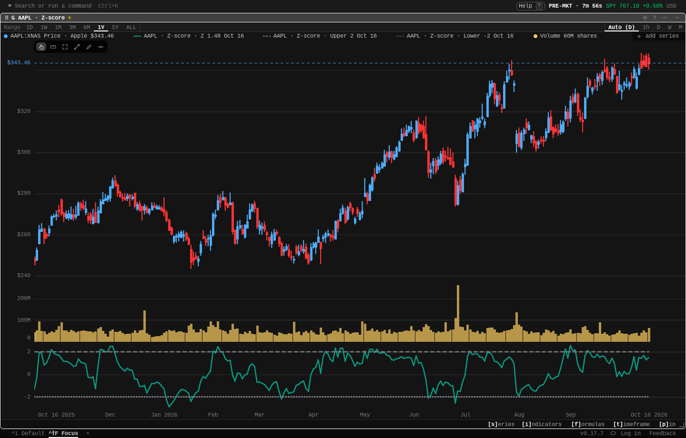

# Pine Scripts for Gloom

Paste a Pine Script® v5 or v6 indicator, save it, and chart it on any ticker.

```pine
//@version=6
indicator("Z-score")
length = input.int(20, "Length")
z = (close - ta.sma(close, length)) / ta.stdev(close, length)
plot(z, "Z", color=color.teal)
hline(2, "Upper")
hline(-2, "Lower")
```



## Install

```sh
gloomberb install gloom-sh/gloom-pine
```

The plugin needs Gloom 0.17.7 or later; an older app does not load it and says which version it needs. It runs in the terminal app and the desktop app. The web app cannot install plugins.

A script runs on your machine with the app's access to it. Only paste scripts you trust.

## Use

1. Type `PINE` in the command bar to open the Pine Scripts pane.
2. Press `n`, paste a script and press `Ctrl+S`. If the script does not run, the error shows under the editor with its line.
3. Press `g`, type a ticker, and the chart opens.

`overlay=true` scripts draw over the price. Other scripts get their own panel under the price. Each `plot()` and `hline()` is a line in the colour the script gives it, a `fill()` between two of them is shaded, and inputs keep their defaults. More examples are in [examples](examples).

Saved scripts work for any ticker, and they show up in three places:

- the data catalog (`CAT`), under "Pine scripts"
- the chart's series search (`s` on a chart): type the script's name
- the command bar: `G CAP:pine:z-score/AAPL`

## Limits

- Only Pine Script v5 and v6 indicators run. For v4 and older scripts the pane asks you to convert them first. Strategies run, but only their plots are drawn.
- A chart draws up to 8 `plot()` and `hline()` lines per script. Some features are not drawn, and the pane lists them under the editor: shapes, chars and arrows, `bgcolor`, `barcolor`, plotted candles and bars, labels, lines, boxes, polylines and tables.
- A line has one colour. A line whose colour changes bar by bar is drawn in its most common colour, and the pane lists "per-bar colors". A plot hidden with `color=na` is not drawn.
- A `fill()` is shaded between two drawn lines, in the colour of whichever line is nearer the fill's. A line takes one fill; a second one, and fills between other things, are not drawn.
- Libraries (`import`) are not supported.
- `request.security()` works for other tickers and for 1, 5, 15, 30 and 45 minute, 1 hour, daily, weekly and monthly bars.
- Inputs always use their defaults. To change one, edit its default in the script.
- A script runs over the chart's bars plus 300 earlier bars, so long averages are already settled on the first bar you see.
- Scripts run one at a time, each with 10 seconds and 1 GB of memory. A script that needs more is stopped, and the app keeps working. Closing a chart stops its script.
- Scripts are saved with your profile and run on your machine. They are never uploaded. Their bars come from Gloom Cloud, the same as any chart.
- You can keep up to 100 scripts, each up to 200,000 characters long.

## License

AGPL-3.0. The plugin runs scripts with [PineTS](https://github.com/LuxAlgo/PineTS), which is AGPL-3.0, so the plugin is AGPL-3.0 too.

Pine Script® is a trademark of TradingView, Inc.; this plugin is not affiliated with TradingView.
